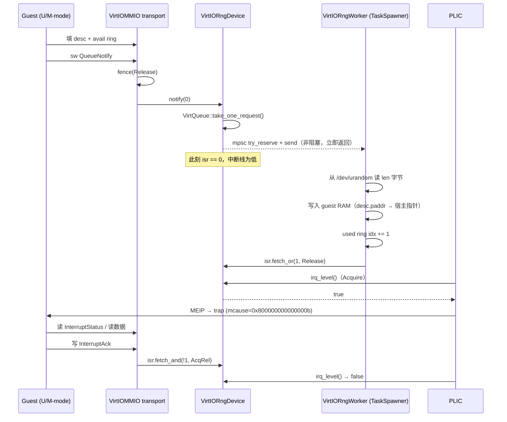

# Chapter 5 交付物：VirtIO-RNG（Device ID 4）

## 1. 选题与要求对照

选题取自 §七「推荐选题方向」表中的 **VirtIO-RNG**（"硬件随机数生成器，响应熵池读取"，
验收方式 `cat /dev/hwrng`）。

| §七 要求 | 落实位置 |
| --- | --- |
| ① 配置 MMIO 基地址 / 大小 + 实现 `DeviceTrait` | `src/board/virt.rs::config::VIRTIO_MMIO_BASE`（0x1000_1000 / 0x1000）；`VirtIOMMIO` 已实现 `DeviceTrait`，设备本体实现 `VirtIODeviceTrait` |
| ② 实现 `PlicDevice` + 分配 `PeriphIrqId` 注册到 PLIC | `VirtIOMMIO::irq_level()` 转发到设备的 `irq_level()`；IRQ 由 `builder.add_virtio_device(.., VIRTIO_IRQ_BASE=1, ..)` → `add_plic_device` → `PLIC::register_device` 完成 |
| ③ 用 `TaskSpawner` 派发异步任务，不阻塞主线程 | `VirtIORngWorker: DeviceTask`，在 `VirtIORngDeviceBuilder::get_and_spawner_task()` 里注册；`notify()` 只做 `mpsc::try_reserve()` + `permit.send()`，永不阻塞 |
| ④ 后台线程写完共享 RAM 后用 `Ordering::Release` 更新 `isr` | `VirtIORngWorker::serve()`：写 guest RAM → `completion.complete(len)` → `isr.fetch_or(1, Ordering::Release)`；`irq_level()` 用 `Acquire` 读 |

> 注：章节文档里的 `src/device/config.rs` **在仓库中不存在**，地址常量实际在
> `src/board/virt.rs` 的 `pub mod config`。

## 2. 数据通路



## 3. 内存序：为什么必须 Release/Acquire

工作线程和 PLIC 采样线程**共享同一块宿主内存**（`Ram`），中间没有任何锁：

```rust
// worker：先写数据，再发布
buf[i] = entropy;                        // 普通写
completion.complete(len);                // used ring idx: store(Release)
isr.fetch_or(1, Ordering::Release);      // 发布点

// 主线程：先观察，再读数据
self.isr.load(Ordering::Acquire) != 0    // 观察点
// → 之后 guest 读到的 buffer 一定是最新的
```

如果 `isr` 用 `Relaxed`，编译器/CPU 可能把中断标志先刷出去而 buffer 写入还留在
store buffer 里，guest 就会拿到**旧的随机数**——这种 bug 几乎无法复现，只能靠规范
保证。

## 4. 设备不带 config 空间

VirtIO 1.0+ 的 `virtio-rng` 没有 device-specific config 空间，所以
`read_config()` 恒返回 0、`write_config()` 是空实现。
（注意：transport 的**寄存器区**（< 0x100）强制 4 字节访问，但 **config 区**
（≥ 0x100）支持 1/2/4/8 字节——这一点和网上一些说法相反。）

## 5. 验证

### L1：Rust 单测（秒级）

```bash
cargo test --profile fast-debug virtio_rng
```

三个用例：

| 用例 | 断言 |
| --- | --- |
| `serves_one_request_and_publishes_with_release_isr` | 提交后 `used.idx` 仍为 0、`isr` 仍为 0；worker 跑完后 `used.idx==1`、`id==0`、`len==32`、`isr==1`、`irq_level()==true`、guest buffer 内容正确；ACK 后电平下降 |
| `reset_clears_status_isr_and_queue` | `reset()` 清 status/isr/queue |
| `rejects_guest_features_beyond_host_capability` | 超出 host 能力的 feature 必须由**设备侧**清 `FEATURES_OK` |

### L2：裸机 C 驱动

```bash
make -C ./test_resources bin/virtio_rng_test.elf
./target/fast-debug/here ./test_resources/bin/virtio_rng_test.elf \
    --device=virtio-rng --max-cycles 300000000
```

实际输出：

```
========== START src/virtio_rng_test.c ==========
[INFO] virtio-rng found (version 2)
[INFO] first 8 bytes: 0x50 0x45 0x49 0xc4 0xb4 0xfe 0x1 0xb
[INFO] virtio-rng ok: 2 requests served
PASS
```

覆盖：magic/version/device-id 探测、feature 协商、队列初始化、两次完整事务、
中断 claim/ack、`used.idx` 与 `used.ring[i].len` 校验、随机性抽样检查。

### L3：Linux 内核验证（已完成）

前置：

```bash
sudo apt install -y device-tree-compiler        # 提供 dtc
# 从 prebuilt-kernels release 下载 linux-busybox-rv64gc.bin（28 MB）
```

步骤：

```bash
# 1. dts 里的 virtio_mmio@10001000 节点默认是注释掉的，必须先解除注释
dtc -I dts -O dtb -o ./dts/virt.dtb ./dts/virt.dts

# 2. release 构建（Linux 启动对性能敏感）
cargo build --release

# 3. 启动，挂上 RNG
./target/release/here /path/to/linux-busybox-rv64gc.bin \
    --dtb=./dts/virt.dtb --device=virtio-rng
```

guest 内（注意 `initramfs` 的 `/dev` 不是 devtmpfs，必须先挂载）：

```
~ # mount -t devtmpfs devtmpfs /dev
~ # readlink /sys/bus/virtio/devices/virtio0/driver
../../../../../bus/virtio/drivers/virtio_rng          ← 驱动已绑定

~ # od -An -tx1 -N 32 /dev/hwrng
 9a c5 d3 b2 36 73 e2 cb 73 c5 85 f3 c2 4c 6e ca
 e8 10 cf db f1 d7 cd 01 bf 89 e2 99 d4 9e 43 94

~ # dd if=/dev/hwrng bs=16 count=1 2>/dev/null | od -An -tx1
 e3 c9 1d ba 36 1c 42 56 96 2a eb 0e 7b cd 21 10   ← 两次结果不同
```

内核日志（关键三行）：

```
[ 0.704268] probe of 10001000.virtio_mmio returned 0 after 31910 usecs
[ 1.951872] probe of virtio0 returned 0 after 21171 usecs
[ 1.956211] random: crng init done
```

- `10001000.virtio_mmio` 的 probe 成功 → **transport 寄存器语义符合规范**
- `virtio0` 的 probe 成功 → **Linux 的 `virtio_rng` 驱动完成 feature 协商 + 队列初始化**
- `crng init done` 紧跟其后 → **内核真的从我们的设备取了熵来播种 CRNG**

关机时还会看到 `virtio_rng virtio0: shutdown`，进一步确认 `virtio0` 就是我们的设备。

> **一个坑**：直接 `cat /dev/hwrng` 会报 `No such file or directory`。
> 不是设备没起来，而是 initramfs 里的 `/dev` 是静态 tmpfs，devtmpfs 没挂载。
> `mount -t devtmpfs devtmpfs /dev` 之后 `hwrng` 就出现了。

> **另一个坑**：模拟器进程一启动就会读 stdin，而 guest 的 ttyS0 驱动在 probe 时
> 会清空 FIFO，所以启动前写进去的按键会被丢掉。自动化时要用
> 「持续发回车 + 延迟发命令」的方式，不能一次性 pipe 进去。

## 6. 踩到的坑

1. **`VirtQueueAvail::mut_ring(base, n)` 收的是宿主指针**，不是 guest 物理地址。
   传 `0x8000_2100` 会直接让模拟器宿主进程 SIGSEGV。
2. **`VirtQueue` 没有 `pop_avail()` / `push_used()`**。真实 API 是
   `take_one_request(|desc, idx| …) -> Option<VirtQueueCompletion>` +
   `completion.complete(len)`，或同步封装 `manage_one_request(|desc, idx| -> u32)`。
3. **`match` 多分支必须显式标注 `Box<UnsafeCell<dyn VirtIODeviceTrait>>`**，
   否则两个 arm 返回不同类型无法统一。
4. **`FEATURES_OK` 的撤销是设备侧责任**：transport 只做 `status |= new_bits`。
5. **裸机 `printf` 不支持 `%u`**，只支持 `d / o / x / f / s / c / %`。
6. **PLIC IRQ 非法是 `assert!` panic**，不是静默丢弃；上限 64，ID 0 保留。
7. **`dts/virt.dts` 里 virtio 节点默认是注释掉的**，不改 dts 直接启动 Linux，
   内核根本不会去探测 0x10001000，`/sys/bus/virtio` 会是空的。
8. **initramfs 的 `/dev` 不是 devtmpfs**，要先 `mount -t devtmpfs devtmpfs /dev`，
   否则 `/dev/hwrng` 找不到但设备其实工作正常。
