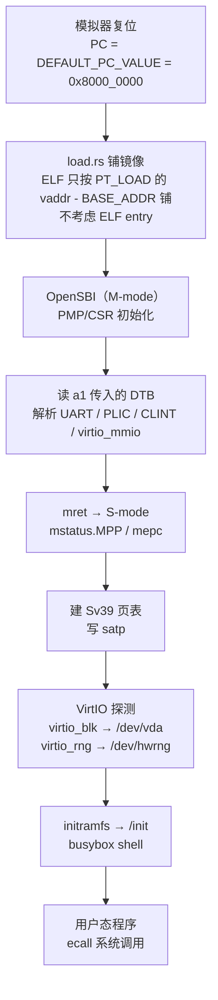

# Chapter 6：Linux 内核启动流程与系统整合

## 1. 这一章在做什么

前五章分别造了 CPU（译码/执行）、特权级与 trap、外设与中断。这一章把它们**装成一台能跑的机器**：
从 `0x8000_0000` 的第一条指令，到一个能执行用户态程序的 Linux shell。

它检验的不是"你写了什么新代码"，而是**整个模拟器的每一环都真的正确**——译码错一条指令、
CSR 少一个字段、PLIC 仲裁错一次、MMU 页表项格式不对，Linux 都会在启动的某一跳上炸掉。

## 2. 启动链路



关键事实（都已核对源码）：

| 事实 | 依据 |
| --- | --- |
| 镜像必须保证 `0x8000_0000` 处是第一条指令 | `DEFAULT_PC_VALUE` 硬编码；`load.rs::load_to_ram` 完全不读 ELF 的 entry point |
| `--dtb` 是递设备树的唯一通道 | `main.rs`：读文件 → 放到 `0x9F00_0000` → `with_reg(11, addr)`，即 **a1 = DTB 地址** |
| a0（hartid）不用设 | 复位后寄存器本来就是 0 |
| DTB 里没写的设备，Linux 就当它不存在 | `dts 节点 → dtc → dtb → 内核解析 → 匹配 compatible → probe 驱动` |

## 3. 与 Chapter 2/3 的关系

仓库里 Chapter 2/3 是**独立分支**（各自从 `master` 分叉），`Chapter5 → Chapter6` 这条线上原本没有它们。
为了让 Chapter 6 分支成为"完整改动"，本次把两章的文件并入工作区：

| 文件 | 来源 |
| --- | --- |
| `data/instr_dict_custom.json` | Chapter3（`padd8` / `psub8` / `padd8_sat` / `pdot4`） |
| `src/isa/riscv/instruction/exec_function.rs` | Chapter3 |
| `src/isa/riscv/instruction/exec_mapping.rs` | Chapter3（替掉原来的 `todo!()`） |
| `src/isa/riscv/cpu_test.rs` | Chapter3（17 个单测） |
| `test_resources/include/custom_ops.h` | Chapter3（Chapter2 版本的严格超集） |
| `test_resources/src/main.c` | Chapter3（含 Golden Model） |
| `test_resources/src/custom_test.c` | Chapter2（Chapter3 没有这个独立测试） |
| `test_resources/Makefile` | 手动合并 `custom_test` 目标 |

> Chapter3 的 `custom_ops.h` 定义了同名的 `padd8` 并额外提供三条指令，`main.c` 也包含 Chapter2 的全部内容，
> 所以 Chapter3 是 Chapter2 的超集。只有 `custom_test.c` 需要单独从 Chapter2 取。
> 两个分支与 Chapter4/5 修改的文件**零重叠**，因此直接取文件不会互相覆盖。

自定义指令受 `--features custom-instr` 控制，涉及 `build.rs`、`decoder/mod.rs`、
`exec_function.rs`、`exec_mapping.rs` 四处。

## 4. 实践 1：Initramfs + VirtIO-Block + 用户态程序

### 4.1 为什么不用 glibc

本机 `/opt/riscv` 只有 newlib 的 `riscv64-unknown-elf` 工具链（裸机语义）。
用它 `-static` 编出来的程序**链接能过，在 Linux 下会直接崩**——因为 newlib 的 `crt0`
不是 Linux 的 `ecall` 约定。

所以 `linux/user_app.c` 用 `-nostdlib` 自己提供 `_start`，直接按 RISC-V Linux syscall ABI 调：

```
a7 = syscall number, a0..a5 = 参数
write = 64, exit = 93, getpid = 172
```

glibc 的 `crt0` 起手式也是一模一样，只是后面还要去调 `__libc_start_main`。

### 4.2 `_start` 必须用 naked 函数

Linux 跳到入口时栈顶布局是 `sp[0]=argc, sp[1..]=argv[]`。
但如果 `_start` 写成普通 C 函数，GCC 会在序言里先 `addi sp, sp, -N` 建栈帧，
等函数体能执行时 `sp` 已经不是内核给的值 —— 读出来 `argc` 恒为 0。

正确做法是把原始 `sp` 在序言之前抓进 a0：

```c
__attribute__((naked)) void _start(void) {
    __asm__ volatile("mv a0, sp");
    __asm__ volatile("tail app_main");
}
```

### 4.3 免 root 制作 ext4 镜像

```bash
dd if=/dev/zero of=block_image bs=1M count=32 status=none
mke2fs -q -t ext4 -F -d ./rootdir block_image
```

两个必须注意的点：

- **必须加 `-F`**：`block_image` 是普通文件不是块设备，`mke2fs` 会交互确认 `Proceed anyway?`，
  在脚本里会卡死。
- **不要给 `mke2fs` 传块数参数**：`mke2fs ... block_image 10240` 会把镜像**重设成 10 MB**（10240 个 1K 块），
  而不是你以为的 40 MB。

免挂载校验内容：

```bash
debugfs -w -R 'ls -l /' block_image
```

### 4.4 设备树改动

`dts/virt.dts` 里 virtio 节点默认是**注释掉**的；而且一个节点只对应一个 virtio 槽位。
本章需要两个设备，所以声明两个节点：

```dts
virtio_mmio@10001000 { interrupts = <0x01>; reg = <0x00 0x10001000 0x00 0x1000>; compatible = "virtio,mmio"; };
virtio_mmio@10002000 { interrupts = <0x02>; reg = <0x00 0x10002000 0x00 0x1000>; compatible = "virtio,mmio"; };
```

IRQ 号必须与 `VIRTIO_IRQ_BASE`（=1）和设备的分配顺序一致。
`IdAllocator` 按 `TypeId` 分组，同一类型的第 n 个设备自动拿到 `base + n*size` / `irq + n`，
所以代码里不需要手写地址，但 **dts 必须跟着加节点**。

## 5. 复核

```bash
# 1. 编译用户态程序 + 制作镜像
bash linux/make_rootfs.sh

# 2. 编译模拟器（含自定义指令，一个二进制覆盖全部章节）
cargo build --release --features custom-instr

# 3. 编译设备树
dtc -I dts -O dtb -o dts/virt.dtb dts/virt.dts

# 4. 启动 + 自动验证（实践 1：initramfs + 用户程序）
bash linux/boot_linux.sh
```

实践 2（Alpine rootfs）多两步：

```bash
# 5. 从 minirootfs 做 ext4 镜像（免 root）
bash linux/make_alpine_rootfs.sh

# 6. 启动 + 挂载 + chroot 验证
bash linux/boot_alpine.sh
```

注意 `boot_alpine.sh` **不要**并发跑两份：它们写同一个 `linux/out/alpine.log`，
会互相覆盖，表现成「guest 卡在提示符不动」。跑之前先清场：

```bash
bash linux/cleanup.sh
```

`cleanup.sh` 会杀掉残留的 `target/release/here`、删掉 `/tmp/here_alpine.fifo`、并对
`boot_alpine.sh` 做 `bash -n` 语法自检。

## 6. 踩坑记录

### 6.1 UART 输入会被周期性丢弃

模拟器 UART 的输入链路有两个特性，导致「定时灌命令」不可靠：

1. `update_rx_status()` 每次只从**有界** channel `try_recv()` **1 字节**（等 guest 读 RBR）；
2. `write()` 里有一句 `while self.input_rx.try_recv().is_ok() {}` —— guest 的 tty 驱动
   打开/复位串口时，会把排队中的输入**全部清空**。

所以固定 sleep 之后一次性 pipe 命令，很可能整批被丢。
`linux/boot_linux.sh` 改成**自适应**：把 stdin 接到 FIFO，轮询日志直到看见 `Please press Enter`
和 `~ #`，再逐条发送（每条间隔 1–4 秒）。

### 6.2 FIFO 打开方式会死锁

```bash
exec 9>  "$FIFO"   # 只开写端：open 会阻塞到有读端出现
"$EMU" ... < "$FIFO" &
```

读端在下一行才启动，双方互等 → 死锁。必须用 `exec 9<> "$FIFO"`（读写方式，不阻塞）。

### 6.3 initramfs 的 `/dev` 不是 devtmpfs

`/dev/vda` 不会自动出现，`cat /dev/hwrng` 会报 `No such file or directory`（其实设备是好的）。
先挂载即可，比 README 里的 `mknod /dev/vda b 254 0` 更通用：

```bash
mount -t devtmpfs devtmpfs /dev
```

### 6.4 自动化必须给 `--max-cycles`

guest 不响应输入时模拟器永不退出。`2e10` cycles ≈ 250 秒 guest 时间，是安全的上限。

## 7. 实践 2：以 Alpine rootfs 启动

### 7.1 预编译内核内建了 initramfs

章节文档说「从项目 Release 下载**无 initramfs 版本**的预编译内核」，但 Release 里三个镜像
（`linux-busybox-rv64gc.bin` / `-with-dtb` / `autopoweroff-`）**全部带 initramfs**。
开机后直接落到 busybox 的：

```
 Welcome to run busybox on RISC-V Emulator
Please press Enter to activate this console.
~ #
```

这一点决定了整个实践 2 的走法：**不要想着绕过 initramfs，要顺着它走**。
真实发行版的 initramfs 干的也正是这件事——找到根设备、挂上、把控制权交给真正 rootfs。

### 7.2 两条走不通的路：`root=` 不管用

先试 `root=/dev/vda`：

```
[    1.850278] virtio_blk virtio0: [vda] 524288 512-byte logical blocks (268 MB/256 MiB)
[   17.849292] VFS: Cannot open root device "/dev/vda" or unknown-block(254,0): error -2
[   17.849625] fe00          262144 vda
[   17.849689]  driver: virtio_blk
```

再试着把内建 `/init` 用 `rdinit=` 顶掉，逼内核走 `prepare_namespace() → mount_root()`：

```
rdinit=/no-such-path init=/sbin/init root=254:0 rw rootwait
```

调用栈确实进去了：

```
[   17.836608] Kernel panic - not syncing: VFS: Unable to mount root fs on unknown-block(254,0)
[   17.852416] [<ffffffff80c01918>] mount_root_generic+0x220/0x2d0
[   17.852620] [<ffffffff80c01baa>] mount_root+0x1e2/0x210
[   17.852825] [<ffffffff80c01ddc>] prepare_namespace+0x204/0x25c
```

但 `mount_block_root()` 仍然返回 `-2`（ENOENT），即使设备号 `254:0` 完全正确、
`fe00 262144 vda` 和 `driver: virtio_blk` 都证明设备已在。

**结论：有内建 initramfs 时，`root=` 这条路由内核自己走不通，别在这上面耗。**

### 7.3 `switch_root` 要求进程是 PID 1

顺理成章的想法是在 initramfs 里手动交接。第一次这么试：

```
~ # switch_root /mnt /sbin/init
BusyBox v1.37.0 multi-call binary.
Usage: switch_root [-c CONSOLE_DEV] NEW_ROOT NEW_INIT [ARGS]
```

`/mnt` 确实是挂载点，参数也没错，却直接打 usage。原因在 busybox 源码
`util-linux/switch_root.c`：

```c
if (st.st_dev == rootdev) {
    // Show usage, it says new root must be a mountpoint
    bb_show_usage();
}
if (!dry_run && getpid() != 1) {
    // Show usage, it says we must be PID 1
    bb_show_usage();
}
```

登录 shell 是 initramfs 里 `busybox init`（PID 1）的**子进程**，所以被这一条挡住。
在 guest 里可以直接验证：

```
~ # echo shell_pid=$$; cat /proc/1/comm
shell_pid=48
pid1_comm=init
~ # switch_root /mnt /sbin/init; echo switch_root_rc=$?
switch_root_rc=1
```

`switch_root` 之所以坚持 PID 1，是因为它接下来要 `rm -rf /`（删掉整个 initramfs），
只有 PID 1 才能安全地做这件事。

### 7.4 走通的做法：挂载 + `chroot` 交接

不去争 PID 1，直接 `chroot`。`linux/boot_alpine.sh` 的全部关键动作只有这几行：

```sh
mount -t devtmpfs devtmpfs /dev          # 不挂就没有 /dev/vda
mkdir -p /mnt && mount /dev/vda /mnt     # virtio-blk → ext4
mkdir -p /mnt/dev /mnt/proc /mnt/sys
mount -t devtmpfs devtmpfs /mnt/dev      # chroot 后必须有 /dev/console
mount -t proc proc /mnt/proc
mount -t sysfs sysfs /mnt/sys
chroot /mnt /bin/sh -c '...'
```

验证输出（`linux/out/alpine.log`）：

```
~ # mkdir -p /mnt && mount /dev/vda /mnt; echo root_rc=$?
[   24.148032] EXT4-fs (vda): mounted filesystem 915473f1-... r/w with ordered data mode.
root_rc=0

~ # echo shell_pid=$$; cat /proc/1/comm
shell_pid=48
pid1_comm=init

~ # chroot /mnt /bin/sh -c '...'
3.24.4
Linux (none) 6.18.2 #45 SMP Wed Jul 22 12:25:27 CST 2026 riscv64 Linux
uid=0(root) gid=0(root)
apk-tools 3.0.9-r0, compiled for riscv64.
https://dl-cdn.alpinelinux.org/alpine/v3.24/main
https://dl-cdn.alpinelinux.org/alpine/v3.24/community
/dev/vda / ext4 rw,relatime 0 0
devtmpfs /dev devtmpfs rw,relatime,size=234860k,nr_inodes=58715,mode=755 0 0
proc /proc proc rw,relatime 0 0
sysfs /sys sysfs rw,relatime 0 0
crw-------    1 root     root       10, 183 Jan  1 00:00 /dev/hwrng
brw-------    1 root     root      254,   0 Jan  1 00:00 /dev/vda
 24 c2 5d 69 24 cc dd c8
NAME="Alpine Linux"
ID=alpine
```

四点值得单独看：

| 链路 | 证据 | 说明 |
|---|---|---|
| virtio-blk → ext4 → Alpine | `EXT4-fs (vda): mounted ... r/w` / `3.24.4` | 块设备路径通了 |
| musl 动态链接 | `apk-tools 3.0.9-r0, compiled for riscv64` | 能跑 install 好的 ELF，说明 `/lib/ld-musl-riscv64.so.1` 与系统调用都没问题 |
| **virtio-rng（第 5 章成果）** | `/dev/hwrng` 是 `10, 183`，`dd` 读出 `24 c2 5d 69 24 cc dd c8` | misc 设备的 hwrng 号，由内核 `virtio_rng` 驱动注册；数据来自我们自己实现的 `VirtIORngDevice` |
| 设备树 → PLIC → 中断 | `/proc/mounts` 里 proc/sysfs/devtmpfs 全部就位 | `earlycon=sbi` + `virtio_mmio@10001000/10002000` 两个节点都命中了 |

其中 `10, 183` 是 Linux 给 `hwrng` 分配的主次设备号，`254, 0` 是 virtio-blk 的。
两个字符/块设备同时出现，等于把第 5 章和第 6 章接成了一条线。

### 7.4.1 不要指望 `exec chroot /mnt /sbin/init` 能拿到 login

试过，会在 Alpine 的 `/etc/init.d/rcS` 里静默卡住（没有 `login:` 提示，也不报错），
因为 busybox init 假定自己是 PID 1。要真正拿到 getty，需要在 initramfs 里自己
当 PID 1 去 `switch_root`，而这又回到 §7.3 的限制。

对一个「验证 rootfs 能被挂起并执行」的实验来说，`chroot` + 一次性验证脚本已经足够，
再往上就要自己做一个 initramfs —— 那是另一章的题目。

### 7.5 dts 声明的 virtio 节点数必须与 `--device` 数一致

`virt-alpine.dtb` 从 `virt.dts` 派生，里面有两个 `virtio_mmio` 节点，
但一开始只挂了 `--device=virtio-block:...`。内核 probe 空的 `0x10002000` 时读 magic
触发访问异常，直接 panic：

```
[    0.509747] [<ffffffff8000f122>] ret_from_fork_kernel+0xe/0x60
[    0.510144] Kernel panic - not syncing: Fatal exception in interrupt
```

（栈顶是 `virtio_mmio_init` → `driver_register` → `platform_probe`。）

**规则：dts 里写几个 virtio 节点，就必须挂几个 virtio 设备。**

### 7.6 不要丢掉 `earlycon`

替换 `bootargs` 时如果漏了 `earlycon=sbi`，内核在 8250 驱动 probe 之前没有任何输出通道，
早期崩溃会表现为「日志停在 OpenSBI 结尾、进程还活着」的静默挂起，非常难查。

实际使用的 bootargs（就是 `dts/virt.dts` 里的原值，一个字都没改）：

```
console=ttyS0 earlycon=sbi initcall_debug
```

注意里面**没有** `root=`：根文件系统由 initramfs 里的脚本手动挂载后 `chroot` 进去（见 §7.4）。

### 7.7 Alpine rootfs 预处理

`linux/make_alpine_rootfs.sh` 做四件事（全部免 root）：

1. `tar --no-same-owner` 解压 minirootfs
2. 把 `/etc/inittab` 里注释掉的 `ttyS0::respawn:/sbin/getty ...` 打开
3. `/etc/securetty` 补 `ttyS0`
4. `/etc/shadow` 里 `root:*:` 改成 `root::`（minirootfs 默认锁定 root，登录会失败）

然后 `dd` + `mke2fs -F -d` 直接从目录建 256MB ext4。
